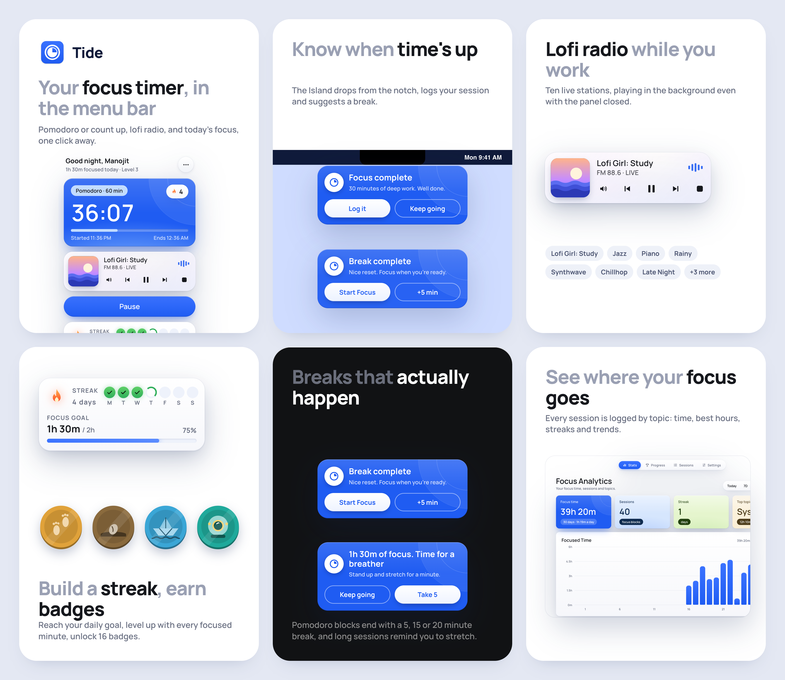
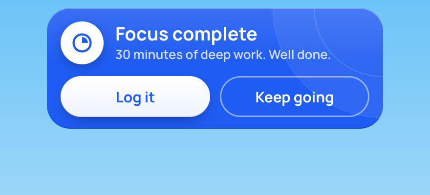
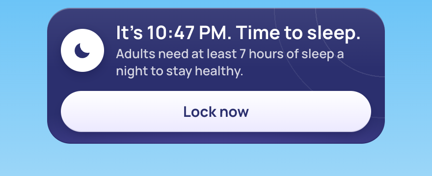
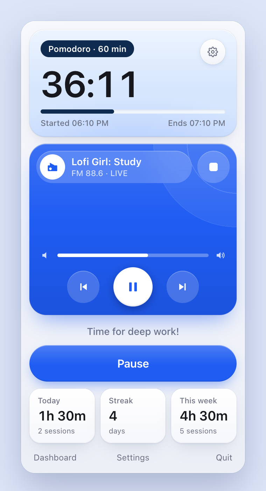
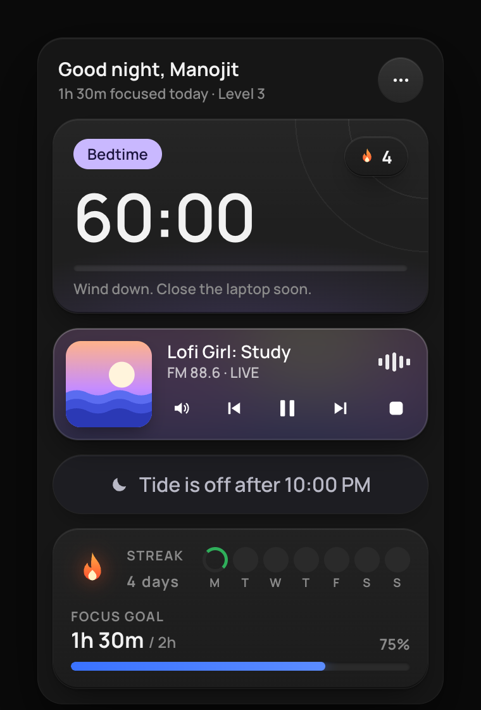
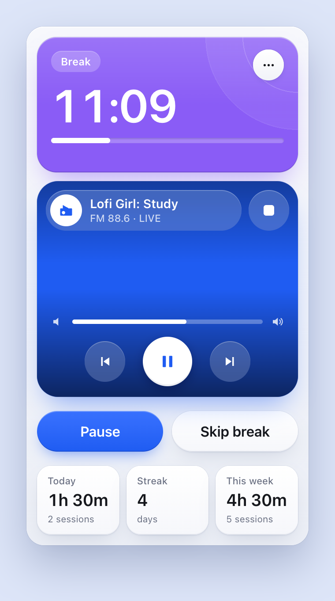
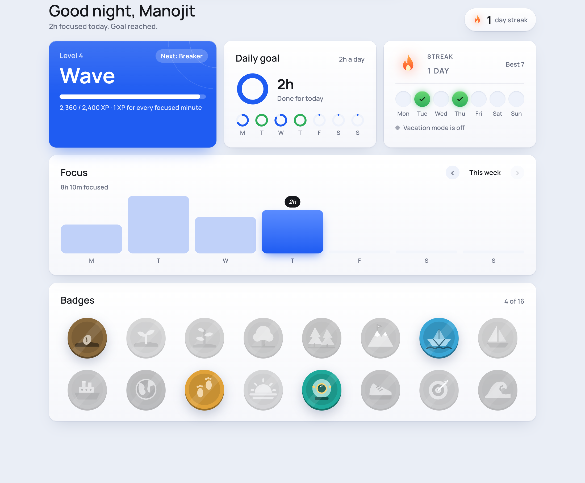
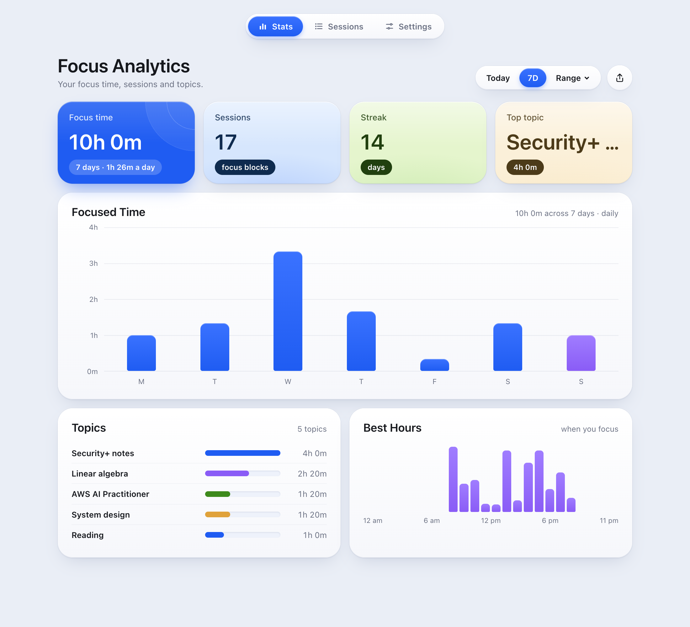

# Tide

A focus timer and lofi radio that lives in your Mac's menu bar. Click the time in the menu bar to open the timer: Pomodoro or count-up, a live lofi station, and your streak and daily goal at a glance. Every session is logged by topic, a dashboard shows where your time went, and at bedtime Tide turns off and nudges you to close the laptop.

**[Download Tide for macOS](https://github.com/manojitnath/tide/releases/latest/download/Tide.zip)** (macOS 13 or later, see [Install](#install))

<p>
  
</p>

<p>
  
  
</p>

<p>
  
  
  
</p>

<p>
  
</p>

## Features

- **Lives in the menu bar.** The running time sits next to a timer icon, with a filling circle (◔ ◑ ◕) for Pomodoro blocks. Click it to open the panel; click anywhere else to close it.
- **Timer:** click the big time to switch between count up and Pomodoro blocks of 30, 60 or 90 minutes (with a 5, 15 or 20 minute break). Pause to see **Resume** and **End focus**. Need a break? End focus and start again when you're back; breaks aren't logged.
- **When a block or break ends** with the panel closed, **the Island**, a card dropping from the notch, drops down with a sound and stays until you answer:
  - *Focus complete:* **Log it** (type the topic right there, then choose a break or another block) or **Keep going** (30 more minutes, logged together).
  - *Break complete:* **Start Focus** or **+5 min**.
  (System *notifications* in Notification Center are only used for app updates.)
- **A nudge when you're idle:** after 30 minutes with no timer or break running, the Island suggests starting a session; **Let's start** starts counting up. It stays quiet from 9 PM.
- **Fair logging:** a Pomodoro you end early isn't counted, and neither is under a minute of counting up.
- **Radio:** ten lofi live streams (Lofi Girl, Chillhop and others) in a compact player: the station's cover art, play/pause, previous and next, stop, a volume button that slides a slider open, and the station list when you click the station's name. It keeps playing when the panel is closed.
- **Study log:** every counted session is saved with its topic. Recent topics are one click away.
- **Daily goal, streak and level:** the panel greets you and shows your streak (days you reach your daily goal, 2 hours by default) and today's progress. Every focused minute is 1 XP; levels go from Drop to King tide. Vacation mode pauses the streak.
- **Badges:** 21 to unlock for early nights, focus hours, streaks and a few specials, in the **Progress** tab of the dashboard. Hover over one to see what it's for.
- **Bedtime:** from 10 PM (you can change it) the timer turns off until 5 AM, and while you keep using the Mac the Island reminds you every 5 minutes to close the laptop, with a short fact about sleep. If a session is still going at 10 PM, the Island offers **Log hours** or **5 more minutes**; at 10:30 PM the session stops by itself and asks for its topic. From 10:30 PM the Island only offers to lock the screen (**Lock & Rest**), and it gives a small shake every 25 seconds with a new fact until you lock the screen, and comes back when you unlock it. Hover over "Tide is off" in the panel to take a night off for a movie or a party. The Progress tab shows when you closed the laptop each night.
- **Gentle nudges in the Island:**
  - *30 minutes before bedtime:* a heads-up, with **Start last block** if nothing is running.
  - *Morning report:* the first time you use the Mac after 5 AM, when you closed the laptop last night and your lights-out run, with **Start first block**.
  - *Close to your goal in the evening* (within an hour of it, 2 hours before bedtime): **Start 30 min** to keep the streak.
  - *Long count-up sessions:* every 90 minutes, a reminder to stretch, drink water or rest your eyes; **Take 5** pauses and asks you to resume after 5 minutes.
- **Dashboard:** focus time, sessions, streak and top topic for today, 7 days, 30 to 360 days or a custom date range; a focused-time chart; time by topic; the hours you focus best; and a full session list you can tidy up. Export to CSV, or copy today's hours.
- **Shortcut:** ⌃⌥Space (Control-Option-Space) starts or pauses the timer from any app.
- **Open at login**, light and dark mode, and an update notice when a new version is out.

<p>
  
</p>

## Install

1. [Download `Tide.zip`](https://github.com/manojitnath/tide/releases/latest/download/Tide.zip) and unzip it.
2. Move `Tide.app` to your Applications folder.
3. The app isn't notarized by Apple, so the first time, right-click it and choose **Open**, then **Open** again. If macOS still refuses, run this once:

   ```bash
   xattr -cr "/Applications/Tide.app"
   ```

Tide has no Dock icon: look for the timer icon in the menu bar. Right-click it for a small menu (Dashboard, Settings, Check for Updates, Quit); in the panel, the round button next to the greeting opens Dashboard, Settings, the theme (match the Mac, light or dark) and Quit.

## Updates

Tide checks for a new release when it opens and once a day, and tells you with a notification. **Check for Updates…** is in the right-click menu and in Settings. To update, quit Tide, replace the app in Applications and open it again. Your log and settings are kept.

## Where your data lives

Everything is in `~/Library/Application Support/Tide/` (the app was called Focus MN before; on first launch Tide copies your data from the old `Focus MN` folder and leaves that folder as a backup):

- `Study Log.json`: your sessions
- `studyradio.state.json`: timer mode, station, volume
- `tide.game.json`: daily goal, bedtime, vacation mode
- `tide.nights.json`: the last time the Mac was used each night

To keep the log somewhere else, such as a synced notes folder, choose a folder in **Settings → Your log**. Your current log is copied there if the folder doesn't have one yet.

## About the YouTube streams

The radio plays public YouTube live streams through YouTube's official embedded player, shown small as the station art, and finds each stream's current ID by reading the channel's public Live page. It's a personal project, not affiliated with YouTube or the channels. The small player doesn't follow YouTube's size guidelines, and the stream lookup can break when YouTube changes its pages. All music belongs to its creators.

## Build from source

Needs the Xcode Command Line Tools (`xcode-select --install`).

```bash
git clone https://github.com/manojitnath/tide.git
cd tide
./build.sh --install
```

This builds the app and copies it to `/Applications`. `./build.sh --zip` also makes `build.noindex/Tide.zip` for a release. See [CONTRIBUTING.md](CONTRIBUTING.md) for how it fits together.

## License

[MIT](LICENSE)
