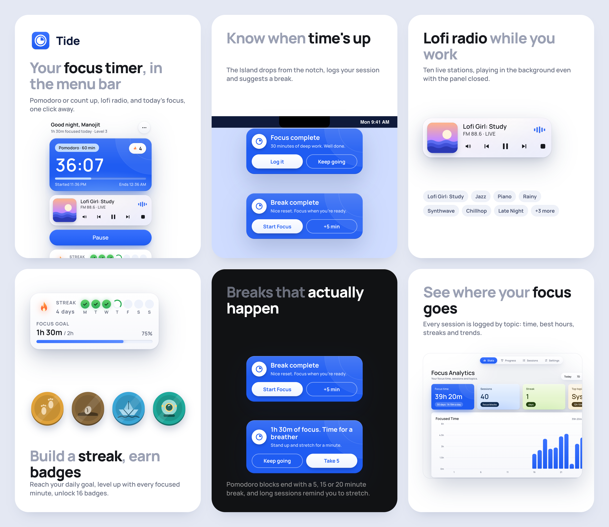
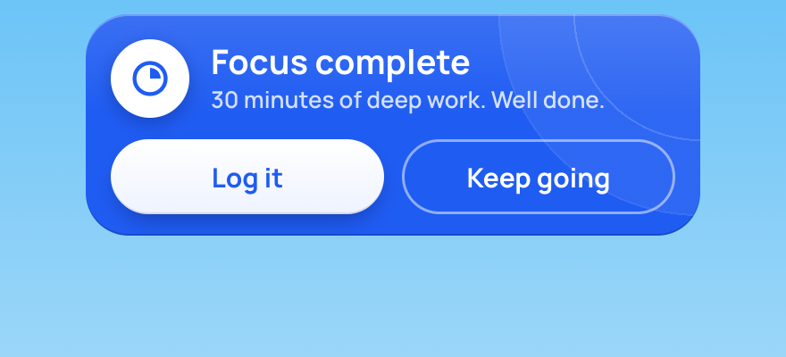
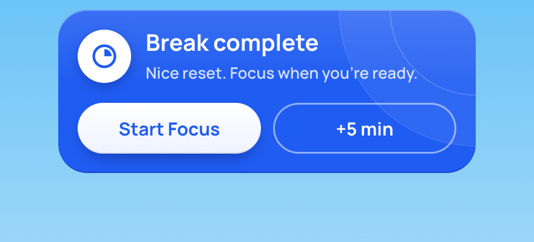
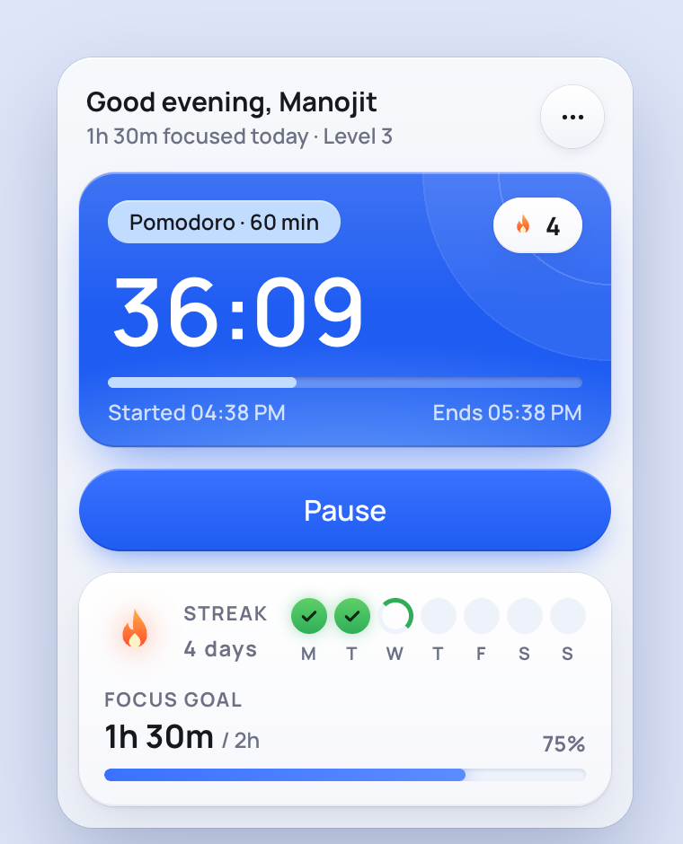
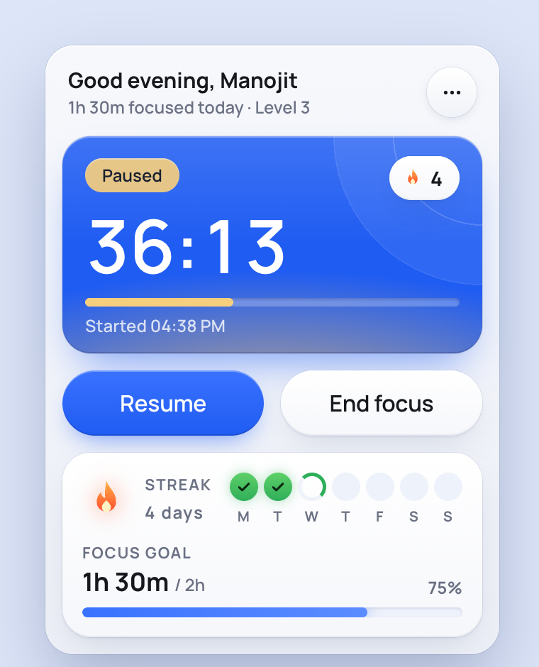
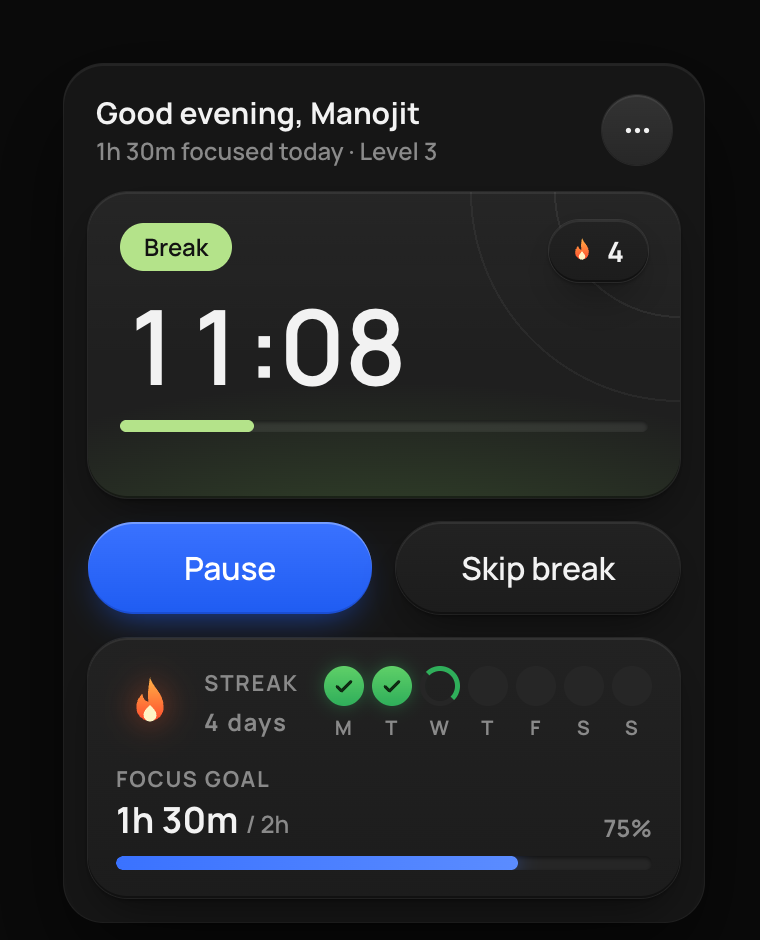
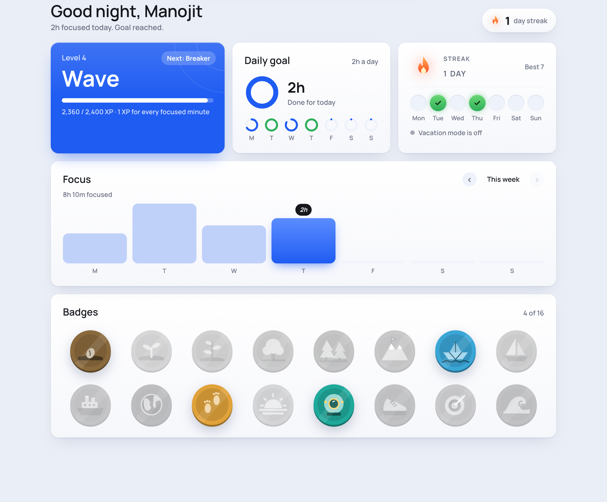
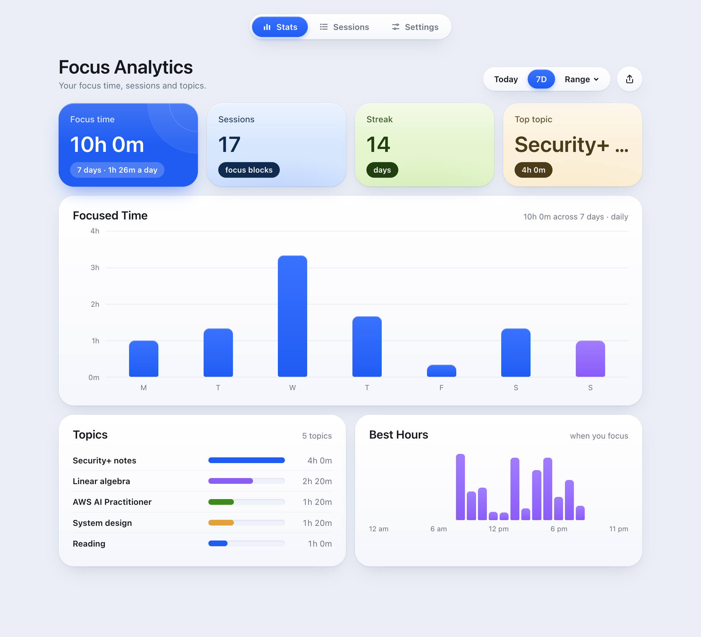

# Tide

A focus timer that lives in your Mac's menu bar. Click the time in the menu bar to open the timer: Pomodoro or count-up, and your streak and daily goal at a glance. Every session is logged by topic, a dashboard shows where your time went, and a daily goal, streak and badges keep you coming back.

**[Download Tide for macOS](https://github.com/manojitnath/tide/releases/latest/download/Tide.zip)** (macOS 13 or later, see [Install](#install))

<p>
  
</p>

<p>
  
  
</p>

<p>
  
  
  
</p>

<p>
  
</p>

## Features

- **Lives in the menu bar.** The running time sits next to a timer icon, with a filling circle (◔ ◑ ◕) for Pomodoro blocks. Click it to open the panel; click anywhere else to close it.
- **Timer:** click the big time to switch between count up and Pomodoro blocks of 30, 60 or 90 minutes (with a 5, 15 or 20 minute break). Pause to see **Resume** and **End focus**. Need a break? End focus and start again when you're back; breaks aren't logged.
- **When a block or break ends** with the panel closed, **the Island**, a card dropping from the notch, drops down with a sound and stays until you answer:
  - *Focus complete:* **Log it** (type the topic right there, then choose a break or another block) or **Keep going** (30 more minutes, logged together).
  - *Break complete:* **Start Focus** or **+5 min**.
  (System *notifications* in Notification Center are only used for the idle nudge below and app updates.)
- **A nudge when you're idle:** after 30 minutes with no timer or break running, a macOS notification (with a sound) suggests starting a session. Hover over it and press **Let's start** to start counting up without opening the panel. Notifications use the **Alerts** style, so they stay on screen until you answer; you can change that in System Settings → Notifications → Tide. There are no notifications between 10 PM and 5 AM.
- **Fair logging:** a Pomodoro you end early isn't counted, and neither is under a minute of counting up.
- **Study log:** every counted session is saved with its topic. Recent topics are one click away.
- **Daily goal, streak and level:** the panel greets you and shows your streak (days you reach your daily goal, 2 hours by default) and today's progress. Every focused minute is 1 XP; levels go from Drop to King tide. Vacation mode pauses the streak.
- **Categories and goals:** group topics into categories like Learning or Content (a topic can be in several), and set a daily or weekly goal for each in **Settings → Categories**. Progress shows in the **Progress** tab, and you can pick or change categories when you save a session. Category chips are only in the panel's end-of-session question, so answering from the Island saves the topic without changing its categories. The streak still depends only on the daily focus goal.
- **Music** isn't built in: play it from any music app alongside Tide.
- **Badges:** 16 to unlock for focus hours, streaks and a few specials, in the **Progress** tab of the dashboard. Hover over one to see what it's for.
- **Dashboard:** focus time, sessions, streak and top topic for today, 7 days, 30 to 360 days or a custom date range; a focused-time chart; time by topic; the hours you focus best; and a full session list you can tidy up: edit a session's topic, times or focus time (for when you forgot to stop the timer), delete it, or **add** one you did without the timer. Export to CSV, or copy today's hours.
- **Shortcut:** ⌃⌥Space (Control-Option-Space) starts or pauses the timer from any app.
- **Open at login**, light and dark mode, and an update notice when a new version is out.

<p>
  
</p>

## Install

1. [Download `Tide.zip`](https://github.com/manojitnath/tide/releases/latest/download/Tide.zip) and unzip it.
2. Move `Tide.app` to your Applications folder.
3. The app isn't notarized by Apple, so the first time, right-click it and choose **Open**, then **Open** again. If macOS still refuses, run this once:

   ```bash
   xattr -cr "/Applications/Tide.app"
   ```

Tide has no Dock icon: look for the timer icon in the menu bar. Right-click it for a small menu (Dashboard, Settings, Check for Updates, Quit); in the panel, the round button next to the greeting opens Dashboard, Settings, the theme (match the Mac, light or dark) and Quit.

## Updates

Tide checks for a new release when it opens and once a day, and tells you with a notification. **Check for Updates…** is in the right-click menu and in Settings. To update, quit Tide, replace the app in Applications and open it again. Your log and settings are kept.

## Where your data lives

Everything is in `~/Library/Application Support/Tide/` (the app was called Focus MN before; on first launch Tide copies your data from the old `Focus MN` folder and leaves that folder as a backup):

- `Study Log.json`: your sessions
- `studyradio.state.json`: timer mode and settings
- `tide.game.json`: daily goal, vacation mode, categories and goals

To keep the log somewhere else, such as a synced notes folder, choose a folder in **Settings → Your log**. Your current log is copied there if the folder doesn't have one yet.

## Build from source

Needs the Xcode Command Line Tools (`xcode-select --install`).

```bash
git clone https://github.com/manojitnath/tide.git
cd tide
./build.sh --install
```

This builds the app and copies it to `/Applications`. `./build.sh --zip` also makes `build.noindex/Tide.zip` for a release. See [CONTRIBUTING.md](CONTRIBUTING.md) for how it fits together.

## License

[MIT](LICENSE)
